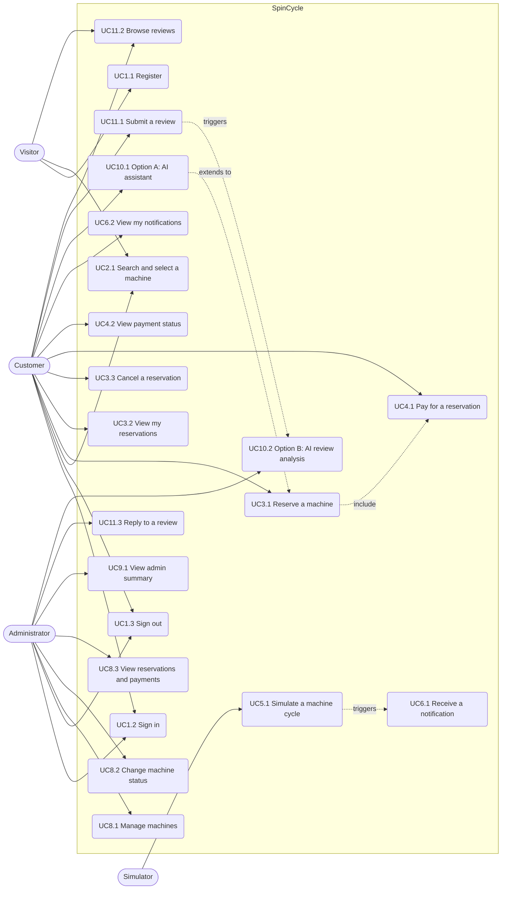
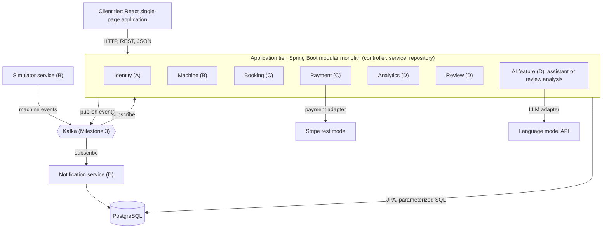
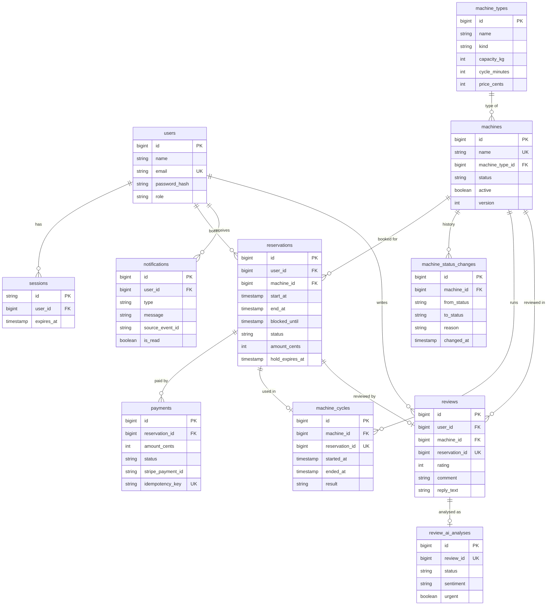
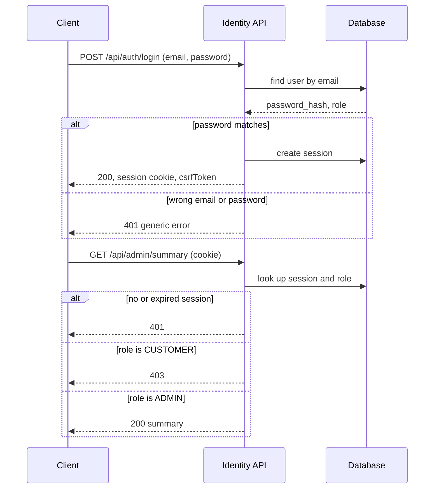
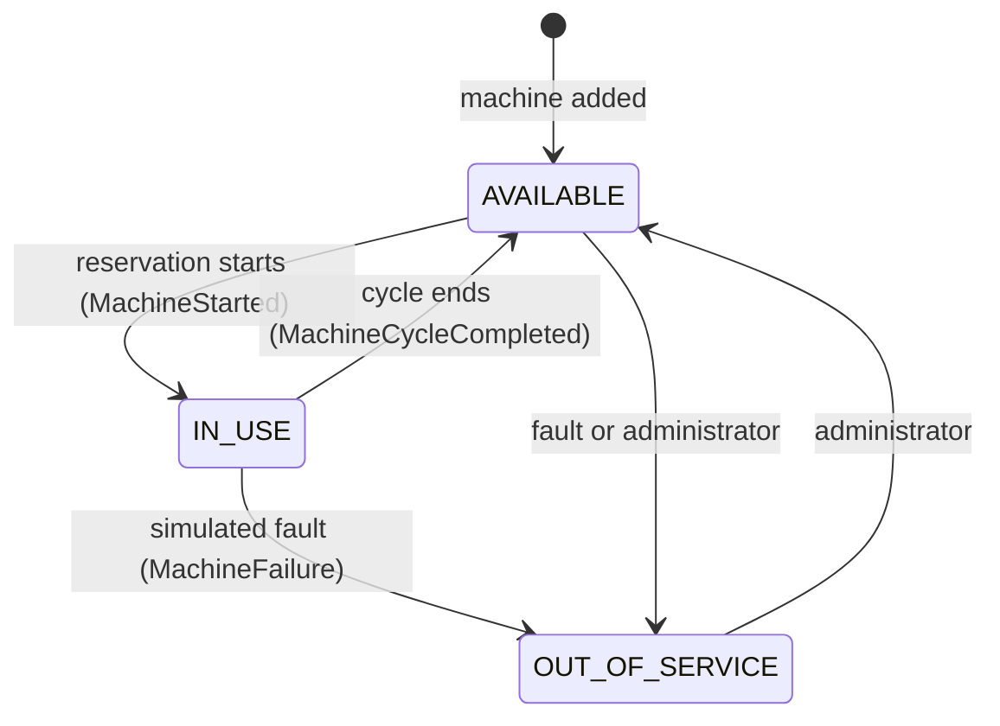
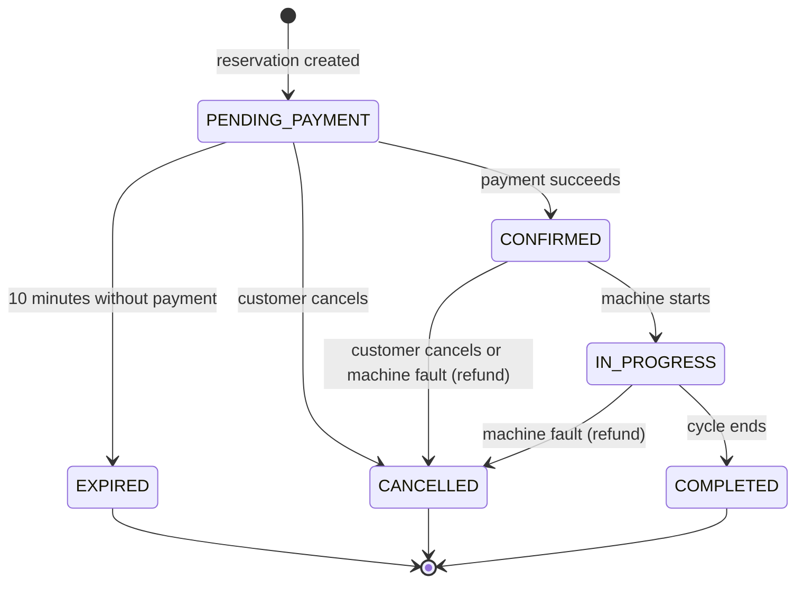
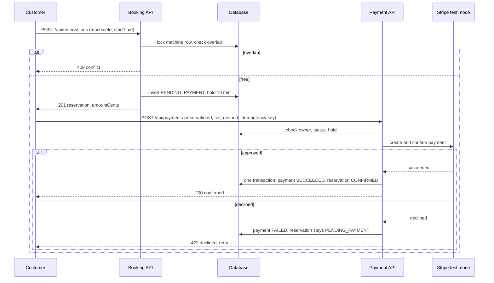
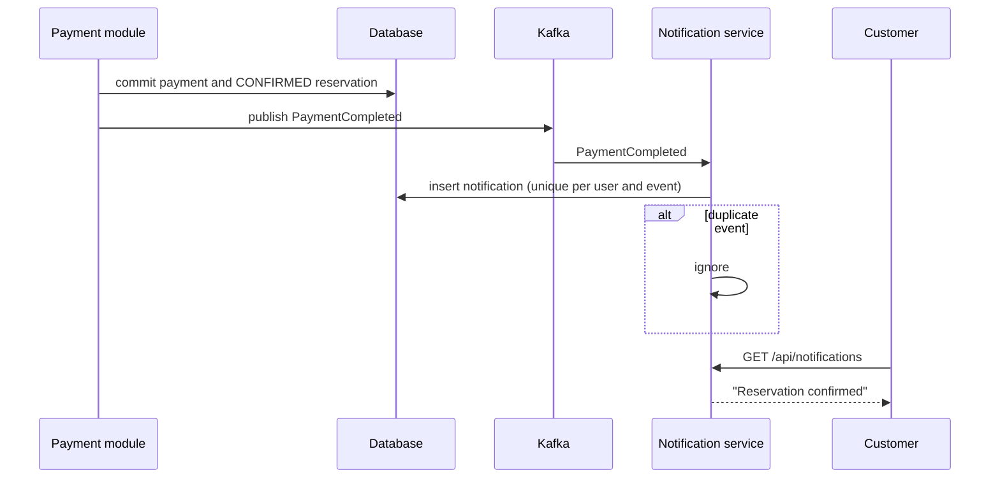

# SpinCycle M1 diagrams (Mermaid sources)

Paste each block (without the backticks) into https://mermaid.live and export a PNG. Figure numbers match the M1 document.

## Figure 1. Use-case diagram

## Figure 2. Architecture overview

## Figure 3. Entity-relationship diagram

## Figure 4. Sign-in and a protected request

## Figure 5. Machine status

## Figure 6. Reservation status

## Figure 7. Reserve and pay

## Figure 8. PaymentCompleted to notification

